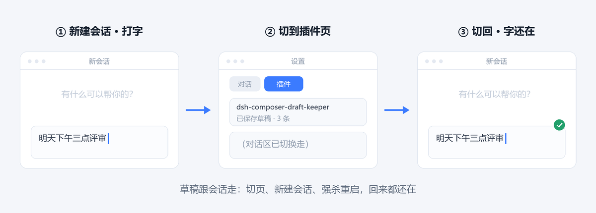

# dsh-composer-draft-keeper

> 没发出去的草稿，切了会话也不丢。

<!-- 动图位置：现在是三帧静图。真 GIF 做好后，把下一行换成下面注释里那行。 -->


<!-- 真 GIF 版本（录制方法见 docs/readme-visual.md）：

-->

## 装

```bash
dsh plugin --profile desktop add github:wangkohan/dsh-composer-draft-keeper
```

桌面端跑这条命令前要先**完全退出 DSH**（不是最小化到托盘）。这是宿主自己的限制，报错原文：
`then fully quit it before running dsh plugin --profile desktop.`

装完重启 DSH（客户端模块在启动时按内容生成带哈希的地址，不重启页面会白屏）。

## 它解决的是什么

**场景**：你在输入框里敲了半屏，想起要确认一件事，点「新建会话」开了个新的；
或者切到设置页看一眼插件。回来之后，输入框是空的。刚才那段字没了。
多数人这时候会以为自己记错了，然后重敲一遍。

**根因**不在输入框，在读草稿的那段代码。DSH 官方源码里是这样：

```js
function readConversationDraft(sessionId) {
  const empty = { text: ``, references: [] };
  if (typeof localStorage === `undefined`) return empty;
  try {
    const raw = localStorage.getItem(`dsh.conversation.${sessionId}`);
    if (raw === null) return empty;            // ← 断点在这里
    const stored = JSON.parse(raw);
    ...
  } catch (_error) { return empty }
}
```

点「新建会话」就是换一个新的 `sessionId`。新 id 在 localStorage 里查不到，
`raw` 是 `null`，函数直接返回空草稿。

关键点是：**旧草稿并没有被删除，它还好端端地躺在 `localStorage` 里**，
只是没有任何一条代码路径会去读它。所以这不是「数据丢了」，是「数据找不回来」。

dsh-composer-draft-keeper 做的就是补上这条读取路径：输入停下 300ms，就在自己的命名空间里留一份镜像
（`dsh.draft-keeper.v1.*`）；下次进到这个会话、并且官方输入框确实是空的时候，再通过宿主的官方输入通道
（`inputActions.setDraft` + `persistDraft`）把内容放回输入框。

**为什么不直接把内容写进 `dsh.conversation.<sessionId>`**：官方那层 persist 是同步、零延迟、整键覆写的——
用户在输入框里再敲一个字，外部写进去的值就被内存态冲掉了。跟它抢这个键必输，所以这里改成跟着官方通道走。
不 patch 官方任何函数。

## 功能

| 功能 | 说明 |
|---|---|
| 跨会话保留 | 新建会话、切设置页、切工作区之后回来，输入框里的文本草稿还在 |
| 发送后不回灌 | 发送成功立刻清键；写回前再校验一遍「当前确实是空白新会话」。两道闸门，堵掉旧草稿串回输入框、两段内容连成一行的历史 bug |
| 崩溃恢复 | 输入停下 300ms 就落盘（不是等发送才落），所以强杀进程、重启 DSH 之后草稿仍在 |
| 互不串味 | 每条草稿按会话独立存放，工作区 A 和 B 各存各的；同一会话内换工作区，草稿跟着会话走，不会被搬走 |
| 多槽位历史 | 默认保留最近 10 条（可调），设置页点「历史」展开看更早的草稿，只读查看、不自动回填 |
| 容量上限 | 总量 256KB，超限淘汰最旧的；写满时先淘汰再重试一次，仍然失败就静默放弃，不弹窗、不阻塞输入 |
| 管理界面 | `settings.section` 里一张卡片：草稿列表、每条可展开历史、逐条删除、一键清空（带二次确认）、总开关、历史条数与容量上限可调 |
| 纯本地 | 没有任何网络请求，数据只写在本机 localStorage |

中文输入法这块单独说一句，因为它是中文用户的生死线：拼音还在拼的时候（`compositionstart` 到
`compositionend` 之间）不落盘，上屏之后再补存一次。否则你会看到存进去的是半截拼音字母。

### 和同类插件的分工

市场里已经有几个做「草稿」的插件，差别不在功能清单，在**存在哪儿**：

| | 存储 | 关掉应用 |
|---|---|---|
| `dsh-composer-draft-cache` | `sessionStorage` | 没了 |
| 本插件 | `localStorage` | 还在 |

`dsh-composer-draft-cache` 的源码注释自己写得很明白：`Storage is browser-lifetime only: an in-memory map plus a sessionStorage`。
浏览器生命周期一到（关窗、退出应用）就清空。所以它能扛切会话、切页面，扛不住关闭应用和重启 ——
而这恰恰是「写了一半去睡觉，第二天再打开」最常见的场景。本插件写 `localStorage`，
强杀进程、重启 DSH 之后草稿仍在。

另外两个只管**附件**：`XWIDE/dsh-draft-keeper` 和 `2026heshao/dsh-draft-attachments`，
处理的是输入框里未发送的图片和文件（走 IndexedDB），不碰文本。本插件只做文本草稿。
三个可以同时装，各管一样东西，不冲突。

选哪个看你怕丢什么：怕关窗丢 → 本插件；只在应用开着的时候想在会话间挪草稿 → `dsh-composer-draft-cache` 也够。

## 隐私

纯本地。零网络请求，没有任何遥测、没有账号、没有云端同步。

数据只写在你自己的浏览器存储里（`localStorage`），不出本机。设置页里可以一键清空，
卸载之后 DSH 官方功能不受影响。

## 卸载与清理

```bash
dsh plugin --profile desktop remove dsh-composer-draft-keeper
```

子命令名以 `dsh plugin --help` 的输出为准（不同宿主小版本偶尔改名）。如果 CLI 删不干净，
手动清两处：`C:\Users\<你>\.dsh\profiles\desktop\node_modules\dsh-composer-draft-keeper` 目录，
以及该 profile 下 `package.json` 里的依赖条目 —— 依赖项留在那里，下次启动仍会尝试加载。

插件自己的键都在 `dsh.draft-keeper.*` 前缀下，想删干净就在 DSH 里开开发者工具
（`Ctrl+Shift+I`）的 Console 跑一行：

```js
Object.keys(localStorage)
  .filter(k => k.startsWith('dsh.draft-keeper'))
  .forEach(k => localStorage.removeItem(k));
```

官方键 `dsh.conversation.<sessionId>` 不要动 —— 那是 DSH 自己的草稿数据，
插件对它只做「读-改-写」合并，从不整键删除，卸载后官方照常读写。

## 兼容性

| 项 | 值 |
|---|---|
| 宿主版本 | `>=0.2.0-rc.1 <0.3.0-0` |
| 实测版本 | 待补（验证员回报后填入） |
| 依赖 | 除宿主自带的 `react` 外零依赖 |
| 平台 | 桌面版（Electron）；浏览器版未验证 |

<!-- TODO(发布前)：实测版本号、以及 0.2.x 各 rc 的行为差异确认后补齐 -->

## License

MIT © 2026 wangkohan — 见 [LICENSE](LICENSE)。

---

## English summary

**dsh-composer-draft-keeper** keeps unsent **text drafts** alive across session switches in DeepSeek Harness.

The upstream reader bails out as soon as the key is missing:
`if (raw === null) return empty;` — and "New session" means a new `sessionId`, so the key is
always missing and the composer comes back blank. The old draft is still sitting in
`localStorage`; nothing ever reads it. This plugin adds that read path: it captures the draft
into its own slot on session change and restores it on return, with two write gates so a sent
message can never be replayed back into the box. Per-workspace namespacing, 10-slot history,
256KB cap with eviction, and a settings panel for review/delete/wipe.

Text drafts only — `dsh-draft-attachments` handles unsent attachments, a different thing.
Fully local: zero network requests, no telemetry.

MIT.
